# Tutorial 01 — Answers

## Part I

### Question 1
```text
I:read numbers a and b  
P:product = a*b  
O:display product 

Start
read numbers a and b  
product = a*b  
display product  
Stop
```

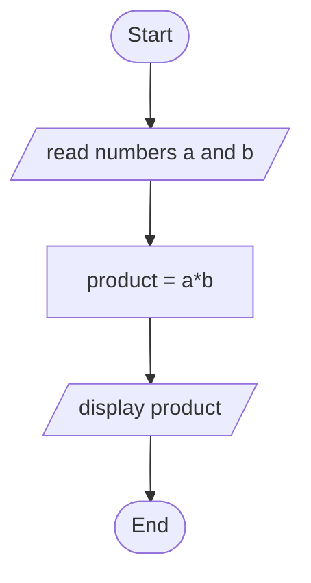
### Question 2
```text
I:a generated random number n  
P:compare n with 50  
O:display comparison result

Start  
generate random number n  
if(n>50)  
    display "Greater than 50"  
else  
    display "Lower than 50"  
end if  
Stop
```

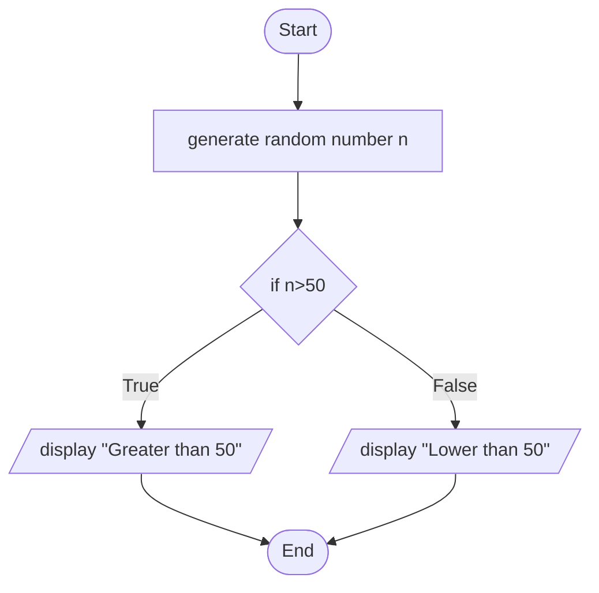
### Question 3
```text
I:mark
P:check validity and compare mark with 40
O:"Invalid mark" or "Pass" or "Fail"

Start
read mark
if(mark<0 or mark>100)
    display "Invalid mark"
else if (mark < 40)
    display "Fail"
else
    display "Pass"
end if 
Stop
```
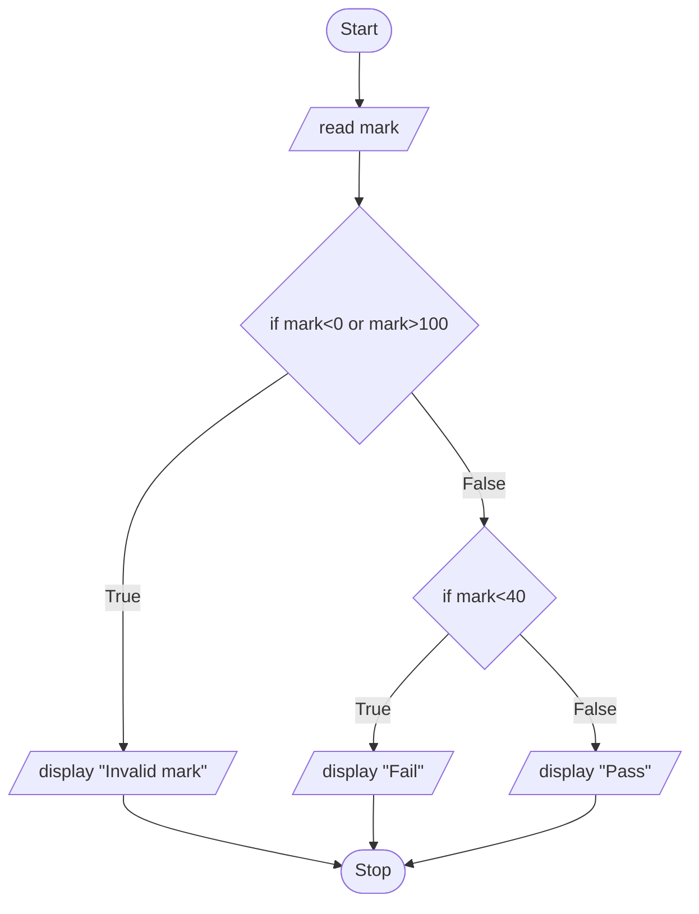
### Question 4
```text
I:read dice 1 ,d1 and dice 2,d2
P:compare d1 and d2
O:display winner or tie

Start
read dice 1 ,d1 and dice 2,d2
if(d1 = d2)
    display "Tie"
else if (d1 > d2)
    display "Player 1 win"
else
    display "Player 2 win"
end id
Stop
```

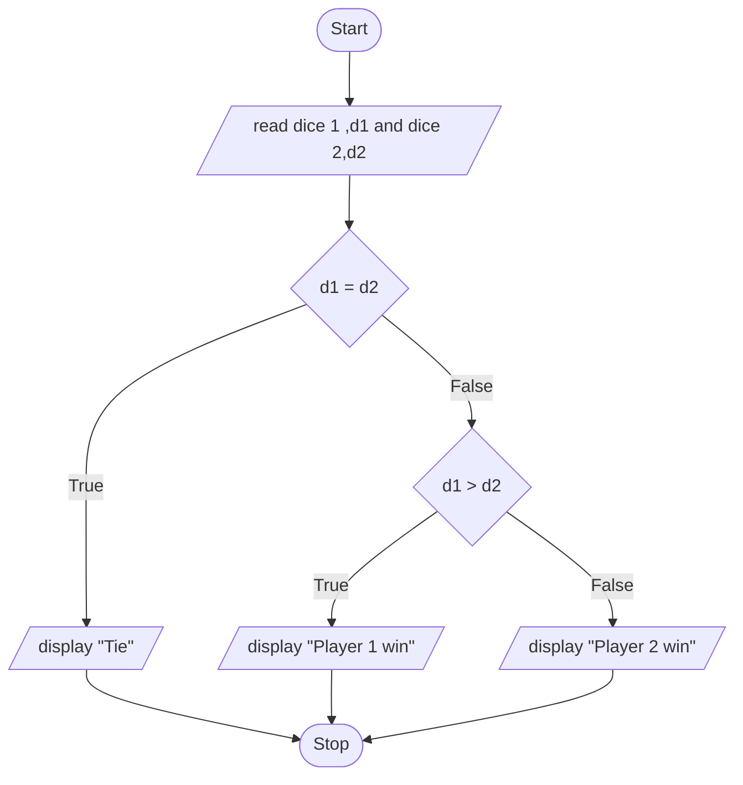
### Question 5
```text
I:read width and length
P:calculate perimeter 
O:display perimeter

Start
read width and length
perimeter = 2*(width + length)
display perimeter
Stop
```
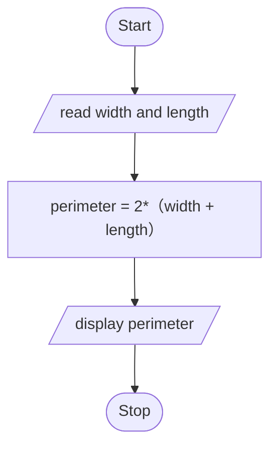
### Question 6
```text
I:10 generated random numbers
P:compare each number
O:display the minimum number

Start
generate a random numbers,a
min = a
count = 1
while(count < 10)
    generate a random number, n
    if(n < min)
        min = n
    endif
    count++
end while
display min
Stop
```
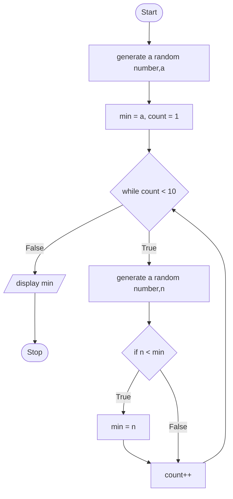
### Question 7
```text
I:10 generated numbers (10 - 100)
P:modulus numbers by 2 and count even and odd number
O:display total of even and odd number

Start
even = 0
odd = 0
count = 0
while(count < 10)
    generate random number，n(10 - 100)
    if(n%2 = 0)
        even++
    else
        odd++
    end if
    count++
end while
display even , odd
Stop
```

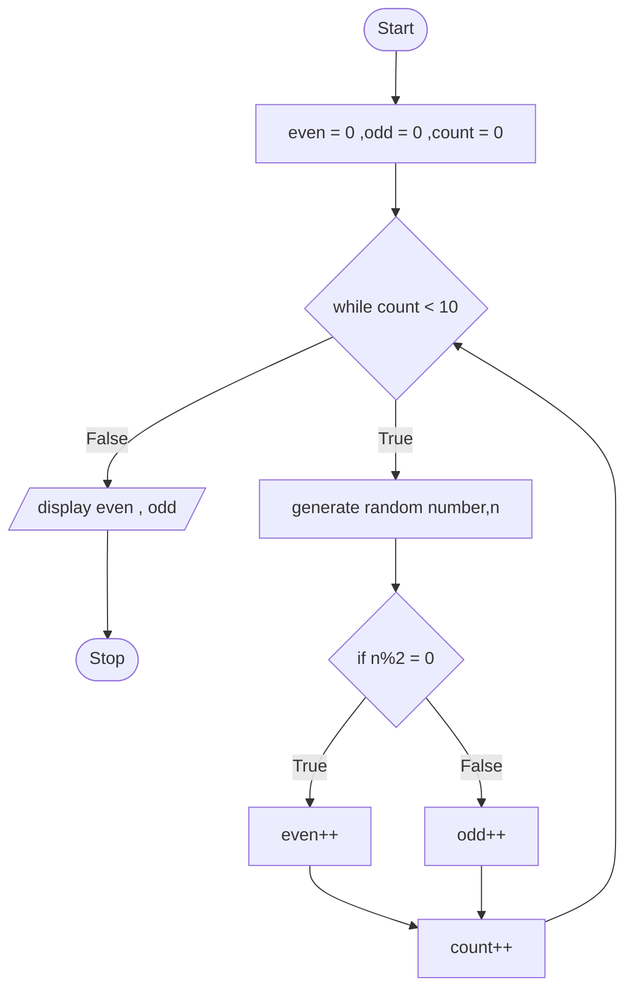
### Part 2

### Question 8
```text
I:read sentence
P:count number of U and M in sentence
O:display number of U and M in sentence

Start
read sentence
numU = 0
numM = 0
count = 0
while(count < sentence.length)
    c = char.At(count)
    if(c == 'U')
        numU++
    else if(c == 'M')
        numM++
    end if
    count++
end while
display numU and numM
Stop
```
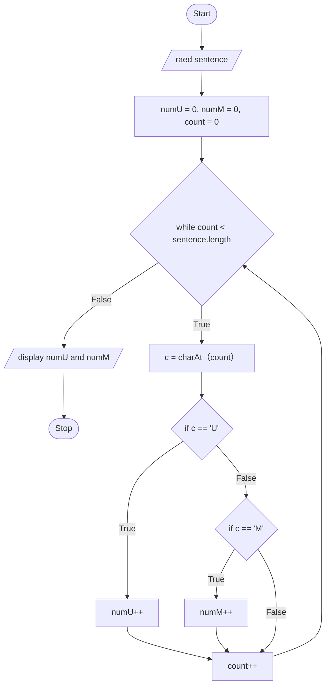

### Question 9
```text
I:raed webpage text and keyword
P:inspect frequency of keyword in text
O:display frequency

Start
read webpage text and keyword
String[] words = text.toLowerCase().split([^a-z0-9]+)
count = 0
for(i = 0, i < words.length, i++)
    if(words = keyword)
        count++
    end if
end while
display count
Stop
```
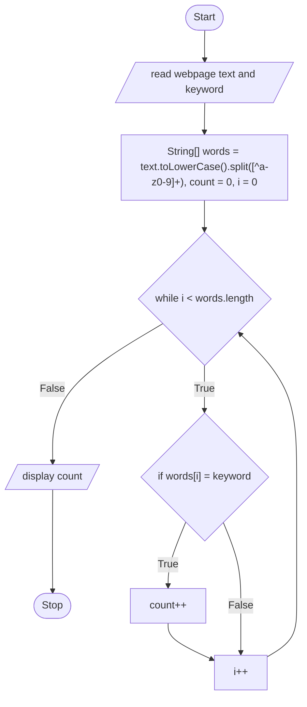

### Question 10
```text
I:read student list
P:inspect number of female student
O:display the number

Start
i = 0
count = 0
while (i < 100)
    read gender for student i
    if(gender = female)
        count++
    end if
    i++
end while
display count
Stop
```
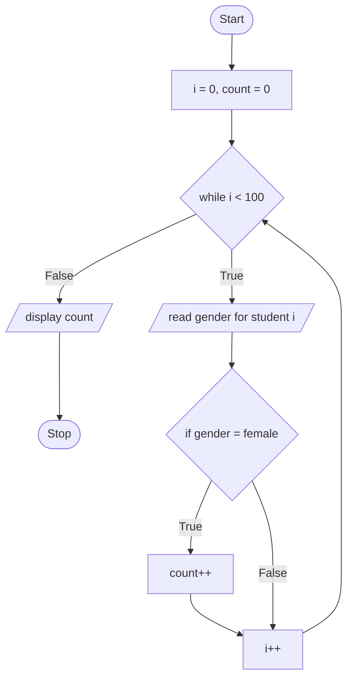
### Question 11
```text
I:5 generated random numbers
P:sort the numbers list in descending
O:display list

Start
generate 5 random numbers in a list
current = list[0]
j=0
i=0
while(i < 4)
    while(j < 4)
        if(list[i] > current)
            temp  = current
            current = list[i]
            list[i] = temp
        end if
        j++
    end while
    i++
end while
display list
Stop
```
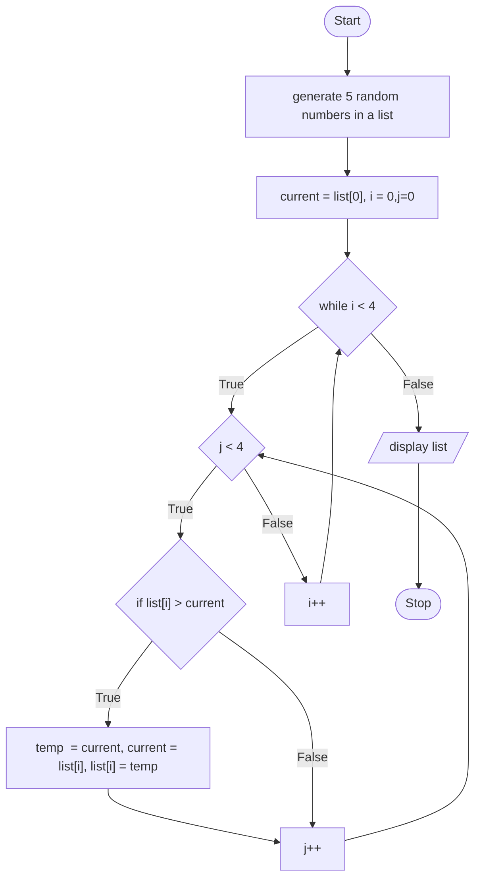
### Question 12
```text
I:guess
P:compare guess with target
O:"Higher" or "Lower" or "Correct"

Start
generate a random number,a
read guess,n
if (a = n)
    display "Correct"
else if (n > a)
    display "Lower"
else
    display "Higher"
end if
Stop
```
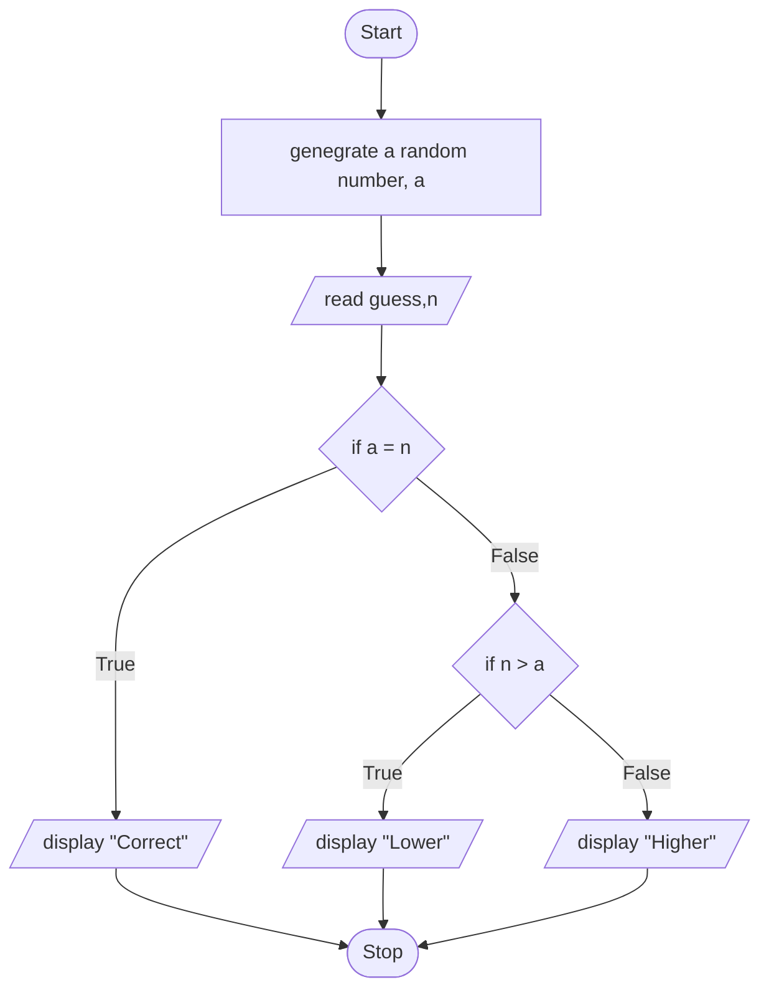


